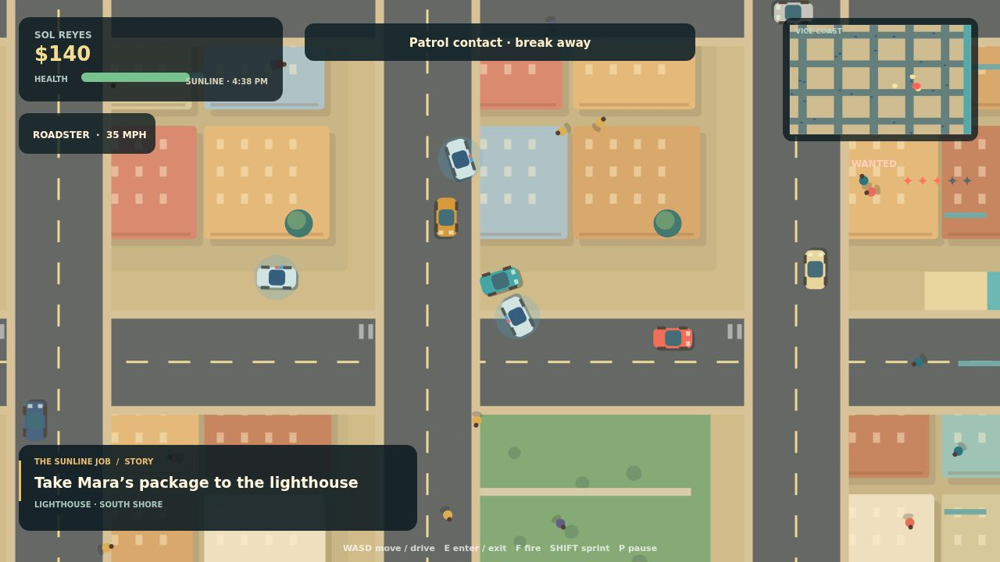

# Sunline: Vice Coast

Sunline: Vice Coast is an original, offline coastal crime adventure. Explore its sunlit street grid on foot or behind the wheel, take cars, work Mara's story, and lose the patrols as they respond to stolen vehicles and gunfire.

[Play and follow the entry on make.fun](https://make.fun/bounty/gta6-01)

## Run locally

Serve `game/` with any static HTTP server and open `game/index.html` in a desktop browser. It uses only local HTML Canvas and vanilla JavaScript files and works offline.

## Controls

- WASD / arrow keys: move and drive (Up accelerates, Down brakes or reverses)
- E: enter or exit a vehicle
- Mouse click or F: fire while on foot; mouse position aims
- H: restore health at the clinic for $50
- C: toggle high contrast player outline and screen border
- P: pause or resume; Enter resumes; Escape returns to the title

Steal a car to start the Sunline job, find Mara by the marina, then deliver her package to the lighthouse. Patrols respond to stolen cars and gunfire; break line of sight and keep moving until the heat fades. Explore side streets for three cash stashes. Position, cash, health, story progress, and stashes save in this browser.

## Coast Run

At the marina, press **R** to accept the Coast Run: a 90-second delivery sprint through four named checkpoints, ending at the beacon steps. Follow the orange route on the minimap and the highlighted next gate on screen. The clock stops at completion; the payout starts at $650 and falls with elapsed time, with a $150 minimum. Timeouts reset the route so it can be tried again. Cash and your fastest completed time persist with the rest of your local save.

The HUD shows health, cash, wanted level, the active objective or courier timer and checkpoint, nearby traffic, patrols, stashes, and route markers on the minimap. High contrast mode is available at any point during play. No network requests, external assets, build tools, or runtime dependencies are used.

## Screenshots

## License

MIT
