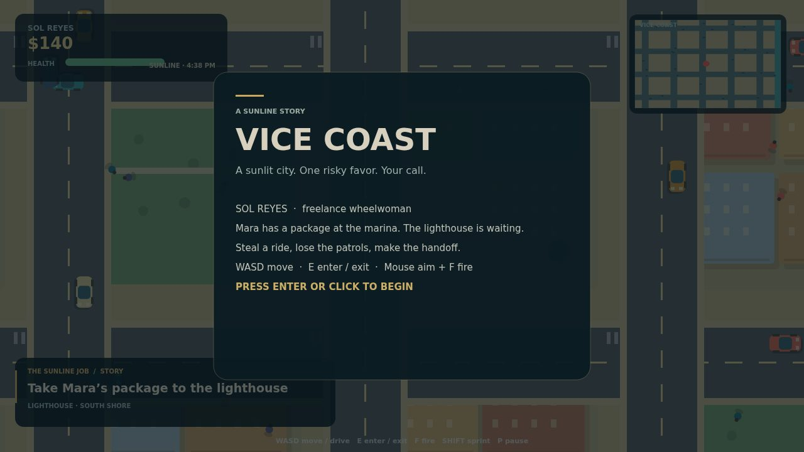
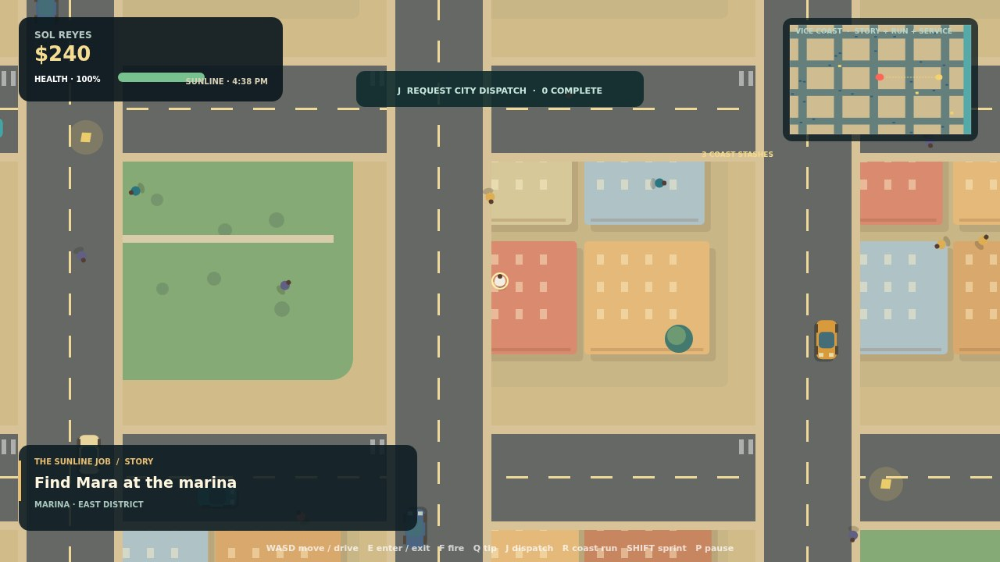

# Sunline: Vice Coast

Sunline: Vice Coast is an original, offline coastal crime adventure. Explore its sunlit street grid on foot or behind the wheel, take cars, work Mara's story, and lose the patrols as they respond to stolen vehicles and gunfire.

[Play and follow the entry on make.fun](https://make.fun/bounty/gta6-01)

## Run locally

Serve `game/` with any static HTTP server and open `game/index.html` in a desktop browser. It uses only local HTML Canvas and vanilla JavaScript files and works offline.

## Controls

- Enter or click: start from the title; click also resumes from pause
- WASD or arrow keys: move on foot; in a car, Up accelerates, Down brakes or reverses, and Left/Right steer
- Shift: sprint on foot
- E: enter a nearby car or exit your current car
- Mouse movement aims; click or F fires while on foot
- R: start or replay Coast Run while at its marina gate
- H: restore health for $50 (works anywhere during play)
- C: toggle the high contrast player outline and screen border
- P: pause or resume; Enter also resumes; Escape returns to the title while paused
- M: show the map marker color guide

Explore on foot or take a car, find Mara by the marina, then deliver her package to the lighthouse. Patrols respond to stolen cars and gunfire; get far enough away for long enough to lose them, then stay quiet while the wanted level cools. Explore side streets for three cash stashes. Position, cash, health, story progress, and stashes save in this browser.

## Coast Run

Go to the marina gate and press **R** to start Coast Run. Pass its four gates in order—Marina gate, Canal bend, Lighthouse road, and Beacon steps—within 90 seconds. The HUD names the next checkpoint and shows the countdown; follow the orange route on the minimap. Completion pays $650 minus $8 per elapsed second, rounded to a whole dollar, with a $150 minimum. A timeout resets the run; return to the marina gate and press **R** to retry. Your cash and best completed time save in this browser.

## Accessibility

Movement, driving, interactions, firing, pausing, and Coast Run can be operated from the keyboard. Press **C** during play to add a bright outline around the player and a white border around the screen; press it again to turn this high contrast mode off. The canvas has a screen reader label and a concise text description of the controls and objective. The animated game world and HUD are drawn on canvas, so their changing visual information is not exposed as a complete screen reader interface. There are no key remapping, text size, or motion reduction settings.

The HUD shows health, cash, wanted level, the active objective or courier timer and checkpoint, nearby traffic, patrols, stashes, and route markers on the minimap. The game uses local files only and needs no network requests, external assets, build tools, or runtime dependencies.

## Screenshots

## License

MIT
